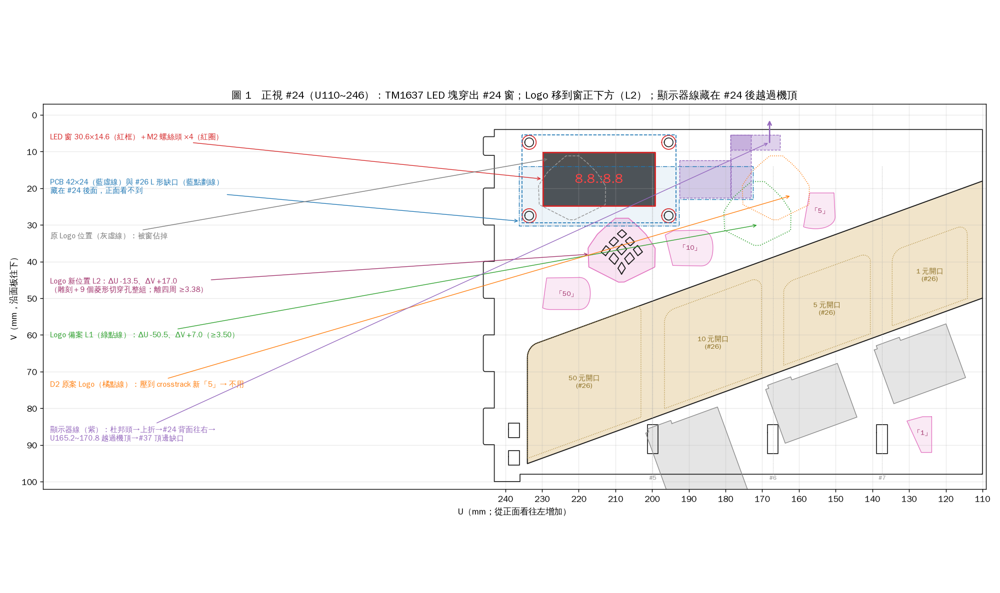
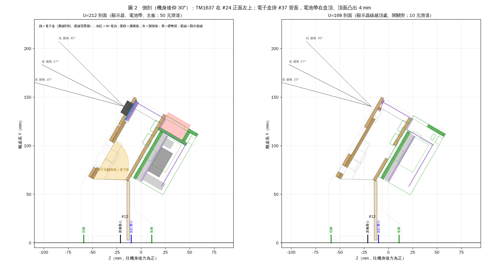
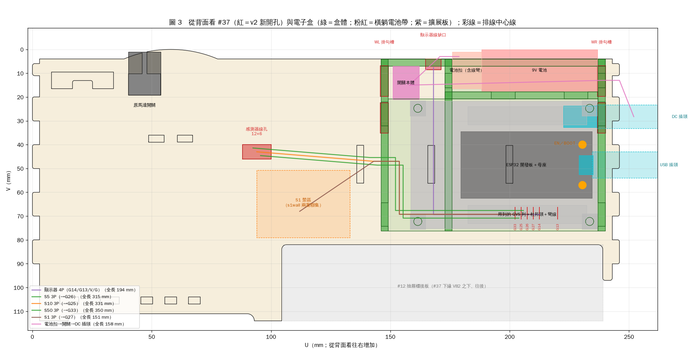
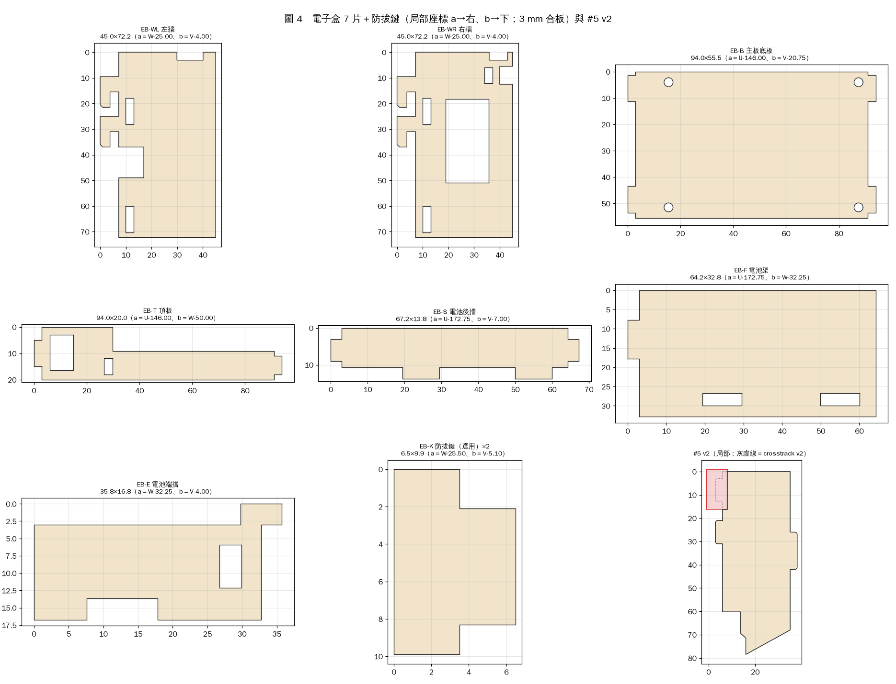

> **勘誤（2026-10-08）**：這個區塊是事後加的，下面內文保留原樣。產生器實作在 `laser_v2/ebox.py`，和內文不同時，以 `laser_v2/out/report.md` 為準。文中的 `scratchpad/v2work/ebox_final/` 是舊位置，現在在 `laser_v2/design/ebox_final/`。
>
> 1. **EB-K 防拔鍵改成 L 形（c-1、c-3、a-3 第 5 步）**：外包 6.5×8.3，不是 6.5×9.9。
>    - 頭 a0～3.5 × b0～8.3，舌 a3.5～6.5 × b2.1～8.3。頭的下緣由 b9.9 改成 b8.3（V15.0→V13.4），和舌齊平。照原形狀，頭會和上層勾唇重疊 1.5 mm，塞不進槽。
>    - 方向：頭比舌長出來的那端（b0～2.1）朝上，齊平的那邊朝下，靠在勾頂上。放反會撞到勾唇。
>    - 裝法：盒子掛好後，從機身內側把舌頭往後塞進上層掛勾槽的上段。
>    - 頭頂高出槽頂 1.8（要求 ≥1.0）。每套另排 2 片備品進切割檔（使用者 2026-10-08 決定）。
> 2. **TM1637 參數（b-1、d-1、d-3、附錄 B）**：
>    - 產生器用的值在 `laser_v2/params.py` 的 `TM1637`；擴展板的值在 `ESP32_BOARD`，數值不變。ebox.py 裡的預設值會被 params 覆蓋；本資料夾的 `params.py` 只給設計腳本用。
>    - `hole_dx`／`hole_dy` 是**半距**，也就是孔中心離 PCB 中心的距離（b-1 的 M2 孔中心是 (Uc ± hole_dx, Vc ± hole_dy)）。實量孔距 38×20 時，要填 19、10。附錄 B「孔距在 V 方向 >20」指的是全距，相當於 hole_dy >10。
>    - 只改 pcb_w／pcb_h、不改孔距時，產生器的檢查「M2 孔在 TM1637 PCB 上」會不過。
>    - `use_screws=False` 時，#24 不切 M2 孔，改用熱熔膠。
> 3. **感測器線標籤（a-2 第 5 步）**：盒端標籤照原文。另外在模組端貼站名（S5／S10／S50、S1），因為使用者 2026-10-08 決定 #24 正面不刻站名。
> 4. **雕刻樣式**：所有 v2 雕刻（箭頭、字）都是紅色 0.2 mm 線，和原始檔一樣。代號字的字墨離切割線 ≥1.0。

# 電子盒＋TM1637 顯示器：最終合併規格（裁判版，可直接寫產生器）

> 位置：`scratchpad/v2work/ebox_final/`。本文數字全部由同資料夾腳本重算（shapely／numpy；組裝座標以 `python3 -B` 唯讀匯入 repo 的 `laser_v2.frames`、`laser_v2.catalog`，不寫 .pyc）。
> 改 `params.py` 後執行 `python3 -B run_all.py`（model → checks → sens → export → fig），數字、`geometry_final.json`、四張圖會一起更新。checks 約 4 分鐘。
> repo 與原始 SVG 都沒有改動，也沒有 commit。單位一律 mm。
> 圖：`fig1_front.png`（正視 #24 左上）、`fig2_section.png`（側剖，世界座標）、`fig3_back.png`（背視 #37＋電子盒＋排線）、`fig4_parts.png`（新零件展開＋#5 v2）。
> 檢查結果：`checks_out.txt`（230 項，!! 0 項）、敏感度 `sens_out.txt`、產生器輸入 `geometry_final.json`。

---

## 0. 裁判結論

### 0.1 評分

| 設計 | 分數 | 理由（數字為本資料夾重算） |
|---|---|---|
| D1 桅杆盒（顯示器在盒子高出機頂的前板上） | **5.5** | 優點：原始零件只改 #37（2 個長槽），不碰 #24/#26/隔板，與 crosstrack、S1 完全解耦；9V 從盒頂直接拿放；視線分析完整（我重算 LED 下緣越過 #24 頂邊的最小俯角約 10°，與其 9.9° 相符）。缺點：① **整機後倒裕度只剩約 12 mm**（我用其盒子位置粗算合計重心 Z≈−1，後腳 Z10.9；盒頂往後 0.46 N 就翻），接線、勾到線就會倒，要靠改端板後腳（動到 #31/#36 與第 2 張排版）才救得回來；② 顯示器在前面板頂邊後方約 38 mm、高出機頂 36 mm 的桅杆上，俯角 <10° 看不到，外觀突兀；③ 11 片合板＋1 片壓克力上蓋（每套多 1 片壓克力或多 9,071 mm² 合板），RST/BOOT 靠重力回彈按桿，容差只有 −1.25～+2.0；④ DC 插頭限定 L 型；⑤ 每面牆只有一層掛勾，往上提 1.55 N 就脫；⑥ 沒有提供 crosstrack_final 要求的 #37 穿線孔（假設的是舊的 d1/d2/d3 走線）。 |
| D2 顯示器在 #24 正面左上＋開放式掛盒 | **7.0** | 優點：顯示器就在正面板上（我重算各坐／站位置視線偏離 LED 法線 2.6°～39°，無遮擋），PCB 藏在 #24 後面；兩層掛勾、不加蓋（EN/BOOT/USB 直接摸得到）、直頭 L 型 DC 都可；合板 7 片 14,909 mm²；合計重心離後腳 21.7 mm。錯誤與缺漏（已重算）：① **Logo 搬家（ΔU−55.5）會壓到 crosstrack_final 已搬上去的「5」**（外包重疊 0.53 mm²、筆畫最近 0.08 mm），照做會雕在一起；② 上排 M2 孔到 #24 頂邊只剩 **1.8 mm** 料（<2）；③ 盒寬 **零餘裕**（U134→240 用滿 106，擴展板 78.0、電池 17.5 都卡在上限）；④ 換電池要從比盒頂低 14 mm 的口袋捏電池扣往上拔；⑤ #5 的修改說「與 S50 修改各自獨立」，但兩者合起來 #5 只剩 1 支前榫＋1 支後榫，沒有說明；⑥ USB 位置假設開發板偏離擴展板中線 8 mm（18.7 而非 26.75），服務窗位置可能錯；⑦ 沒有提供 crosstrack_final 要求的 #37 穿線孔，S1 線要繞盒頂穿隔牆孔；⑧ 顯示器線在盒內怎麼走沒定案。 |

### 0.2 選定：以 D2 為骨架合併

**最終方案＝D2 的「TM1637 嵌在 #24 正面左上＋掛在 #37 背面的開放式兩層掛勾盒」，盒內改成「電池帶」配置**（9V 橫躺在盒頂、頂面凸出盒頂 4 mm，往上直接拿起；擴展板在下）。

| 來源 | 合併進來的東西 |
|---|---|
| D2 | 顯示器位置與 #24 窗、#26 L 形缺口、#5 前上角讓位的整套做法；兩層掛勾（抬 6.4→推→放）；開放式盒（EN/BOOT/USB 直接摸得到）；右牆服務窗（USB、DC 從機身左端插，直頭 L 型都可）；頂板電源開關；防拔鍵 |
| D1 | 9V 從盒頂直接拿放、電池頂凸出盒頂（D1 是 3 mm，本版 4 mm）＋電池下墊緞帶拉環；「歸零首選開關關再開、要按 EN 用捏的」操作守則；DC 線組免焊選項 |
| 本輪新增／修正 | ① Logo 改搬到窗正下方（L2：ΔU−13.5、ΔV+17.0，離所有東西 ≥3.38，孔背後 0 露出），並給自動備案 L1；② PCB 上緣改由「上排 M2 孔料寬 ≥2」自動算（名目 V5.5，料寬 2.30）；③ 電池改放盒頂後，**盒寬從 106 降到 94、左牆離 S1 禁區 13 mm**，擴展板長可到 93.5（左牆自動左移）；④ 顯示器線越頂處移到 U165.2～170.8，#37 頂邊缺口跟著移；⑤ 依 crosstrack_final 要求開 **#37 感測器線孔 12×6（U88～100、V40～46）**，並給四條感測器線完整路徑與線長；⑥ 左牆前緣開排線口；⑦ 下層掛勾由 V31 移到 V29（左牆在 U146 時勾唇離 5 元翻倒弧 7.65→9.32）；⑧ 擴展板上下各留 1.0（M3 孔四周料寬 ≥2）；⑨ #5 的修改與 crosstrack_final 的 #5 v2 合成一個外形並驗證 1 塊；⑩ 開發板置中（USB 在板中線），EN/BOOT、服務窗跟著算 |

### 0.3 一頁摘要（評分項目逐項）

| 評分項目 | 結果（數字見 e 節與 `checks_out.txt`） |
|---|---|
| 顯示器從正面看得到 | LED 面在 #24 正面左上，凸出 #24 4.2 mm、離桌面 140 mm、面朝前上 30°。坐（眼高桌上 400）、站（800）在 0.4～1.5 m、正前與偏 35°：視線偏離 LED 法線 **2.6°～39.4°**（七段 LED 可視約 ±60°），前方無遮擋 |
| 9V 電池好換 | 電池橫躺在盒頂「電池帶」，頂面凸出盒頂 4 mm，捏住（或拉緞帶）往上直接拿起，電池扣連線一起出來；不用開蓋、不用工具。拔電池時機身往後翻臨界 2.77 N（典型 0.5～1 N） |
| ESP32 USB 可插 | USB、DC 都在機身左端；右牆 16.9×32.75 服務窗，直頭 USB、直頭／L 型 DC 都插得進；插頭外露處離 #36 端板 ≥10.9 mm |
| RST（歸零）可按 | 盒子背面不加蓋，EN/BOOT 鍵正後方 Ø10 手指通道淨空（離盒體 1.5、離線 ≥13.05）。**建議歸零用頂板開關關再開**（往下壓，不會翻）；要按 EN 時用捏的 |
| 排線不進硬幣路徑 | 顯示器線越過機頂開口（V5～10.6，在隔板頂 V14 之上），離所有硬幣區 ≥15.13 mm；感測器線在右側空腔內上升（在 1 元右牆外側），之後全程在 #37 外面（W'≥33）；S1 線全程在 #37 外面 |
| 盒子固定牢靠 | 兩面牆各兩層掛勾（層距 15.5），不能繞 U 軸轉出、不能直接拔；勾唇扣 #37 內面 0.15；選用防拔鍵後連往上抬都不行 |
| 老師組裝簡單 | 顯示器由講師預先鎖在 #24、線兩端預插好；老師：照原流程裝 #24 →線放進 #37 頂邊缺口 →把 4 條感測器線的 1×3 杜邦頭插到 G27/G26/G25/G33 →掛盒（抬、推、放）。不用工具 |
| 用板量少 | 顯示器側不加料（只開孔）。電子盒合板 7 片淨面積 **14,031 mm²**，手排 7 片可放進第 1 張 #24＋#37 下方 245×96.5 長條（佔 240.5×90.5）。第 3 張不增加 |
| 不擋 #37 背面原有東西 | 離原馬達開關 ≥90.25 mm；離 #12 4.66、#21 3.25、#36 3.0 mm；離 S1 禁區 13.0 mm |
| 穩定 | 合計重心離後腳 **21.1 mm（椴木）／22.3 mm（MDF）**，原機 32.3（D1 只剩約 12）。電池在盒頂讓重心比 D2 往後約 0.6 mm，可接受 |

主要代價：#24 Logo 要搬家（L2，請使用者確認外觀）；#24/#26/#5/#37 都要改（#5 合併後只剩 2 支榫）；電池凸出 #37 頂邊 4 mm（俯角 >15° 時從正面看得到電池頂）。





---

## 1. 座標與換算（產生器必讀）

| 符號 | 定義 |
|---|---|
| U | 沿機身長邊，0＝右端轉盤側、246＝左端；從正面看往左增加，從背面看往右增加 |
| V | 沿傾斜面板往下，0＝面板頂。U≥100 處 #24、#37 頂邊在 **V4**；#26 頂邊在 U≥133 為 **V14**（隔板頂也是 V14） |
| W' | 深度，#26 背面＝0，往後為正；#24 −6～−3、#26 −3～0、#37 29～32（內面 29.0、外面 32.0） |
| 世界座標 | 鉛直往下＝(U,V,W')＝(0, 0.866, 0.5)；往後 Z＝−0.5V＋0.866W'；離桌高 Y＝−0.866V−0.5W'＋Y0（端板最低點為桌面）。端板著地 Z −59.0（前腳）～10.9（後腳） |
| #24 局部 | (x,y)＝(V, U)；頁座標＝局部＋(2.637, 146.158)（第 1 頁） |
| #26 局部 | (x,y)＝(V−4, U−40)；頁座標＝局部＋(119.853, 190.677)（第 1 頁） |
| #37 局部 | (x,y)＝(114−V, U)（SVG 鏡像）；頁座標＝局部＋(180.824, 59.417)（第 2 頁） |
| #5 局部 | (x,y)＝(W'+6, V−14.0)；頁座標＝局部＋(165.926, 3.901)（第 1 頁） |
| 新零件局部 | (a,b)＝板面兩軸各減外包最小值（每片的對應寫在 c-3 與 `geometry_final.json → new_parts[*].mapping`） |

`geometry_final.json → mods` 每個多邊形同時給 `asm`（組裝）、`local`、`page` 三種座標（page 由 `laser_v2.frames` 的 4×4 矩陣算出，已驗證：#24 窗 local (10.2,199.2)+原點＝page (12.837,345.358)）。

---

## (a) 概念與安裝步驟

### a-1 概念

| 部位 | 做法 |
|---|---|
| 顯示器 | TM1637（42×24）的 LED 塊從 #24 背面穿出 30.6×14.6 的窗，往前凸出 4.2；PCB 貼 #24 背面，用 4 支 M2 尼龍螺絲鎖在 #24 上（螺絲頭在正面，像邊框）。PCB 在 V5.5～29.5，比 #24 頂邊低 1.5，正面看不到。#26 頂邊開 L 形缺口讓 PCB、彎針排針、杜邦頭進去；#5 前上角讓 2.0 mm 給 PCB 背面零件 |
| 顯示器線 | 4P 杜邦排線出杜邦頭後在 #26 缺口 B 裡往上折（U173～178.6），在 #24 背面 V5～10.6 往 −U 走約 8 mm（熱熔膠點 2 點），在 **U165.2～170.8 越過機頂開口**（V5～8.5，在隔板頂 V14 之上），穿過 #37 頂邊 U 形缺口（U164.75～171.25）進電子盒 |
| 電子盒 | 開放式淺盒掛在 #37 背面 U146～240、V4～76.25、W'32.25～70。左牆 WL、右牆 WR 各有兩層掛勾（勾頸 V13.5 與 V29.0）穿 #37 的 4 個長槽 |
| 盒內（從背面看） | **上：電池帶**（V0～17.5）＝9V 橫躺（長邊沿 U，U188.25～236.75），左邊是電池扣區與端擋 EB-E，再左邊是頂板上的電源開關（U152～161）；**下：擴展板**（U158.5～236.5、V21.75～75.25，盤面朝後，USB／DC 在 +U 端，用到的 GVS 排針列在下緣）；**左側 9.5 mm 走線灣**（U149～158.5）讓感測器線從左牆排線口下到 GVS 列 |
| 不加蓋 | EN、BOOT、USB、GVS 杜邦頭從背面直接摸得到 |
| 感測器線 | S5/S10/S50 照 crosstrack_final：#24 正面 → 右下排線孔 → 右側空腔 → **本規格新開的 #37 感測器線孔**（U88～100、V40～46）→ 沿 #37 背面 V43～47 往 +U → 左牆排線口（V41～53）→ 走線灣 → 插 G26/G25/G33。S1 從 S1 模組排針（#37 背面 U≈112、V≈68）→ 左牆排線口 → G27 |

### a-2 講師預組（每套約 25 分鐘＋膠乾；10 套約 4.5 小時）

1. **盒體（白膠）**，順序很重要（EB-S、EB-F 兩端都是內嵌槽，要先組成子件）：
   1. 子件：EB-E 平放 → EB-F 的 −U 榫插進 EB-E 底緣缺口 → EB-S 的兩支下榫插進 EB-F 的兩個槽、−U 榫插進 EB-E 的槽。
   2. 左牆 WL 平放，插上主板底板 EB-B 的 −U 兩支側榫。
   3. 把子件放上去：EB-F 與 EB-E 的下緣坐在 EB-B 的上緣（V20.75）。
   4. 蓋上右牆 WR：EB-B 的 +U 兩支側榫、EB-S 的 +U 榫同時插進 WR。EB-F 的 +U 端貼 WR 內面（膠接）。
   5. 從上方把頂板 EB-T 壓下：兩端榫進 WL、WR 頂緣缺口，EB-E 的頂榫進 EB-T 的槽。
   6. 用直角尺確認 WL、WR 前緣（掛勾那一邊）在同一平面，膠乾 30 分鐘。
2. **擴展板**：4 支 M3×12 尼龍螺絲從擴展板盤面穿入 → 擴展板 → 2 顆 M3 尼龍螺帽（墊高 4.8）→ EB-B → EB-B 前面 1 顆螺帽。螺絲尖離 #37 外面 0.4。方向：USB／DC 朝右牆 WR、用到的那排 GVS（G13、G14、G25、G26、G27、G33）在下緣。黃色跳帽設 3.3 V。
3. **電源**：買「9V 電池扣＋線上開關＋DC 5.5×2.1 插頭」免焊線組（見 c-4）。開關卡進 EB-T 的 9×13.5 孔，內側點熱熔膠。電池扣端越過 EB-E 頂緣（W'32～50 那段沒有頂板）進電池帶；線組另一端沿電池帶後方通道（W'65～70）到右牆後緣 DC 線口出盒，DC 插頭從服務窗外面插進 DC 座。電池扣線在盒內留約 6 cm 鬆量，電池才能整顆提出。電池下墊一條 5×80 mm 緞帶（兩端露出盒頂），當拉環。
4. **顯示器＋#24**：
   1. 4P 母對母杜邦排線（30 cm）插上 TM1637 彎針（由上而下 CLK、DIO、VCC、GND），排針座與杜邦頭接縫點熱熔膠。
   2. #24 正面朝下，LED 塊從背面塞進窗，排針朝 #24 的轉盤側（−U）。鎖 4 支 M2×8 尼龍螺絲＋螺帽（螺絲頭在正面）。沒有固定孔的模組改熱熔膠，並把參數 `use_screws=False`（#24 不切 M2 孔）。
   3. 線出杜邦頭後立刻往上折 90°，在 U173～178、V6～12 點熱熔膠；再往 −U 平貼 #24 背面到 U168，點第 2 點。**這段必須在 V14 以上**，裝機時才不會被 #26 夾到。
   4. 線的另一端插擴展板：CLK→G14 的 S、DIO→G13 的 S、VCC→任一 V、GND→任一 G（用沒插感測器的欄位）。盒內走法：#37 缺口下來 → 往後越過開關旁 → 沿開發板背後往下到下緣 GVS 列（見 fig3），點 1 點熱熔膠固定在 EB-B。
5. **感測器線的盒端**：每條 3P 線的盒端做成 **1×3 杜邦頭、順序 G-V-S**（從開發板往外黑、紅、藍），貼標籤「S1→G27」「S5→G26」「S10→G25」「S50→G33」。這樣老師只要對欄位插一個頭；插反 180° 只會把 G、S 對調（V 仍在中間），感測器不動作但不會燒。模組端照 crosstrack_final／S1 規格由講師預插。
6. 燒錄程式，放入電池，開機確認顯示 1234 後變 0。
7. 出貨：「#24（含顯示器）＋電子盒＋兩者之間 30 cm 線」一組，線用束帶收在盒內。

### a-3 老師組裝（電子部分約 5 分鐘）

1. 照原流程組整台，換用 v2 的 #24（含顯示器）、#26、#5、#37。裝 #24 時把電子盒放在機器後方桌上，線放鬆；PCB 會沿 W' 直接進到 #26 缺口。
2. 整台組好後：把顯示器線從 #24 背面上緣越過機頂，放進 #37 頂邊 U 形缺口。
3. 感測器線：S5/S10/S50 照 crosstrack_final a-3 第 4 步穿到右側空腔，再從 **#37 感測器線孔**（從背面看在左下，U88～100、V40～46）拉出，沿 #37 背面往盒子方向；S1 線從 S1 模組排針拉過來。四個 1×3 杜邦頭依標籤插到盒內下緣 GVS 列的 G27、G26、G25、G33 欄（盒子還在桌上時插最方便）。
4. 掛盒：雙手拿盒，前緣貼 #37 背面，比最後位置高約 6.4 mm（盒頂約高出機頂 2.4 mm）；4 個掛勾對準 4 個長槽的上段 → 沿 W' 往前推到牆前緣碰到 #37 → 放手，盒子自己滑下 6.4 到底。把感測器線放進左牆前緣排線口。
5. （選用）防拔鍵：手指從機頂開口伸進 5 元滑道頂端與 50 元滑道頂端，把 EB-K 的舌頭往後塞進上層長槽上段（V6.9～13.4）。
6. 打開頂板開關：顯示 1234 → 0。各丟硬幣測試。

### a-4 日常操作

| 操作 | 怎麼做 | 檢查結果 |
|---|---|---|
| 換 9V | 關開關 → 捏住凸出盒頂 4 mm 的電池頂（或拉緞帶）往上提出 → 拔電池扣、扣新電池 → 放回（先放電池扣那端） | 拔出 30 mm 掃掠離盒體 0.25、離 #37 0.30；往後翻臨界 2.77 N |
| 歸零 | **首選**：頂板開關關掉再打開（往下壓，前後都不會翻）。**或**：拇指按 EN、食指從機頂勾住 #37 內面，用捏的 | 單指從背後直推 EN，往前翻臨界 2.12 N（椴木），和輕觸開關的 1.6 N 很接近 |
| 燒錄 | 關開關（紀錄規定燒錄時先斷 9V）→ USB 線從機身左端穿右牆服務窗插上開發板；卡在 Connecting 時按 BOOT | 插頭外露處離 #36 ≥10.9 |
| 拆盒 | 拔防拔鍵（若有）→ 盒子往上推 6.4 → 往後拿出 | — |

---

## (b) 要修改的原始零件

### b-0 產生器流程（與 crosstrack_final 的先後）

1. `catalog.load_catalog()`（已清理：#24 `rect2[18]` 退化切線〔163.5 mm，穿過 #24 本體 118 mm，原樣輸出會把 #24 切出裂縫，終點離本 LED 窗 0.8 mm〕、`rect2[6]`、`path2[1]`、雜線 path9/path174、註記文字）；套 `fix_26_tooth_hole()`（KNOWN_DEFECTS 唯一 apply=True 的項目）。這就是使用者說的「順便修 bug」在雷切檔裡的部分；ESP32 正式程式 `coin_sorter_esp32.ino` 的 `lastPrint = millis();m` 多餘 `m` 已在 repo commit f18f313 修好（本輪重新 grep 確認已無此字串），不在本規格範圍。
2. 先做 crosstrack_final 的全部修改（#24/#26 感測窗、光孔、#6 新槽、排線孔、刪掉的孔、「5」「1」雕刻搬移；#5/#6/#7 v2 外形）。
3. 再做本規格：#24（刪原 Logo 9 孔、加窗、4 個 M2 孔、Logo 9 孔與雕刻平移）、#26（減 L 形缺口）、#5（在 crosstrack v2 外形上再減前上角）、#37（4 個掛勾槽、頂邊缺口、感測器線孔）。
4. 驗證：每片仍是 1 塊；新切割到外框、到其他孔 ≥2.0（#37 ≥2.5）；硬幣開口與軌道零改動。
5. KNOWN_DEFECTS 的兩個 #37 可選項（`divider-rear-tenon` 把三個後榫槽移 0.25、`37-cutout-corners` 下方開口左邊外移 0.4）與本規格的 #37 新切割最近距離 >7 mm（掛勾槽離後榫槽 8.63；下方開口在 V82 以下，本規格最低的切割 V46），套不套都相容。

### b-1 #24 前面板

**參數式**

```
Ur = DISP_UR (193.5)；Vp = 自動 = max(5.0, ceil0.5(4 + MIN_WEB + hole_d/2 + C_SCREW + hole_dy − pcb_h/2)) = 5.5
Uc = Ur + pcb_w/2 = 214.5；Vc = Vp + pcb_h/2 = 17.5
LED 窗 = [Uc − body_dx ∓ body_w/2 ∓ C_WIN] × [Vc + body_dy ∓ body_h/2 ∓ C_WIN]（直角矩形，切穿）
M2 孔 = 圓 Ø(hole_d + 2·C_SCREW) = Ø2.4，中心 (Uc ± hole_dx, Vc ± hole_dy)
Logo = 雕刻 path1-5-9 與它的 9 個菱形切穿孔整組平移 LOGO_SHIFT (ΔU, ΔV) = (−13.5, +17.0)
```

**暫定值**

| 特徵 | 組裝 (U,V) | #24 局部 (x=V, y=U) | 頁座標（第 1 頁） |
|---|---|---|---|
| LED 窗 30.6×14.6 | U199.20～229.80 × V10.20～24.80 | x 10.20～24.80, y 199.20～229.80 | x 12.837～27.437, y 345.358～375.958 |
| M2 孔 ① Ø2.4 | (195.5, 7.5) | (7.5, 195.5) | (10.137, 341.658) |
| M2 孔 ② | (195.5, 27.5) | (27.5, 195.5) | (30.137, 341.658) |
| M2 孔 ③ | (233.5, 7.5) | (7.5, 233.5) | (10.137, 379.658) |
| M2 孔 ④ | (233.5, 27.5) | (27.5, 233.5) | (30.137, 379.658) |
| Logo 平移 | ΔU −13.5、ΔV +17.0；外包 U212.67～230.96×V11.19～28.62 → **U199.17～217.46×V28.18～45.62** | Δ(x,y)＝(+17.0, −13.5) | Δ(x,y)＝(+17.0, −13.5) |

- Logo 做法：原 9 個菱形孔**不輸出**（補回實料）；輸出平移後 9 個孔（`geometry_final.json → mods['#24'][Logo].new_holes`）；雕刻 path1-5-9 整組套頁座標平移 (+17.0, −13.5)。
- **Logo 位置是自動規則**：產生器依序試 L2 (−13.5, +17.0)、L1 (−50.5, +7.0)；條件＝外框內縮 3、離窗／螺絲頭／所有雕刻（含 crosstrack 新「5」「1」）／斜槽／crosstrack 感測窗／轉盤區 ≥3、菱形孔離其他孔 ≥2、孔背後不是 #26 缺口或顯示器線。兩個都不行時跑 `model.build(logo_search=True)` 重新搜尋。名目：L2 最小距 3.38、L1 3.50，兩者孔背後露出都是 0。
- 不用螺絲（熱熔膠）時不切 4 個 M2 孔。
- 註記層：「v2 修改：顯示窗、M2 孔、Logo 移位」。

### b-2 #26 內牆：頂邊 L 形缺口

**參數式**（r_n＝M2 螺帽外接半徑 2.31；L_B＝dup_gap + dup_len + wire_bend＝1+14+5.5＝20.5）

```
A 段（PCB）：U [min(Ur, Uc−hole_dx−r_n) − C_NOTCH, max(Ur+pcb_w, Uc+hole_dx+r_n) + C_NOTCH] × V [頂邊, max(Vp+pcb_h, Vc+hole_dy+r_n) + C_NOTCH]
B 段（彎針＋杜邦頭＋上升線）：U [Ur − L_B − C_NOTCH, A 段左緣] × V [頂邊, Vc + hdr_dy + n·p/2 + C_NOTCH]
多邊形上緣畫到 V13（頂邊 V14 外 1 mm）確保切穿
```

**暫定值**（逆時針；#26 局部 x＝V−4、y＝U−40）

| 點 | 組裝 (U,V) | #26 局部 (x,y) | 頁座標 |
|---|---|---|---|
| 1 | (172.50, 13.00) | (9.00, 132.50) | (128.853, 323.177) |
| 2 | (172.50, 23.08) | (19.08, 132.50) | (138.933, 323.177) |
| 3 | (192.69, 23.08) | (19.08, 152.69) | (138.933, 343.367) |
| 4 | (192.69, 30.31) | (26.31, 152.69) | (146.163, 343.367) |
| 5 | (236.31, 30.31) | (26.31, 196.31) | (146.163, 386.987) |
| 6 | (236.31, 13.00) | (9.00, 196.31) | (128.853, 386.987) |

- 吃掉的原有槽只有 #5 上小榫槽（U198.4～201.3、V17.0～26.9），同步刪 #5 上小榫（b-3）。
- 離 #6 上小榫槽 3.93、#5 第二小榫槽 4.74、crosstrack 新 #6 槽 8.88、#26 左緣 6.69；離 1/5/10/50 元開口 41.23／24.53／20.68／21.87；離斜槽靠背區 16.66。**開口、軌道零改動**。

### b-3 #5（10|50 隔板）：crosstrack v2 外形再減前上角

- **參數式**：#5 v2（crosstrack_final `stations.S50.divider.new_outline.local`）減去局部矩形 x∈[−1, 6+W_cut]、y∈[−1, V_cut−14]，W_cut＝PCB 背面 W'(−1.4)＋back_h(2.6)＋C_DIV(0.8)＝**2.0**，V_cut＝缺口 A 底＝**30.31**。
- **暫定值**：減 x −1～8.0、y −1～16.31（組裝 W'0～2.0 × V14～30.31）。同時刪掉上小榫（y3～13）。
- 合併後外形（局部，逆時針，圓角點省略見 JSON）：`(6,21) 第二小榫 (3,21)～(3,31) (6,31) → (6,60.224) (13.8,60.224) (13.8,69.466) (16,71.466) (16,78.484) → (35,68.002) → (35,42) 後榫 (38,41)～(38,27) (35,26) → (35,0) → (8,0) → (8,16.31) → (6,16.31)`；完整點列 `geometry_final.json → mods['#5'].new_outline_local`（另附 page、WV）。
- 驗證：1 塊、最小料寬 6.0。剩下的定位榫：**第二小榫（V35～45，插 #26）＋後榫（V40～56，插 #37）**；上小榫（本規格刪）與長榫（crosstrack 刪）都沒了。#5 夾在 #26 與 #37 之間不會掉，但定位只靠這兩支榫，試切時要確認不晃（g-2 T5）。
- 雕刻「S50 v2」照 crosstrack；不需再加字。

### b-4 #37 後面板

**參數式**（SLIDE＝lip_len＋0.4＝6.4；C_HOOK＝0.2）

```
掛勾槽：U [U_wall − C_HOOK, U_wall + t + C_HOOK]（U_wall＝146.0、237.0）
        V [n0 − SLIDE − C_HOOK, n0 + neck_h + C_HOOK]，n0 ∈ {13.5, 29.0}
頂邊顯示器線缺口：U [CABLE_U ∓ w/2]（CABLE_U＝168.0、w＝6.5）× V [頂邊 V4, 4 + depth]（depth 4.5），多邊形上緣畫到 V2（板外 2 mm）
感測器線孔：U88～100 × V40～46（crosstrack_final 要求「U72.1～104.9 內 ≥10×5」）
```

**暫定值**（#37 局部 x＝114−V、y＝U；頁座標＝局部＋(180.824, 59.417)，第 2 頁）

| 特徵 | 組裝 (U,V) | #37 局部 (x,y) | 頁座標 |
|---|---|---|---|
| 槽 1（WL 上層）3.4×12.8 | U145.80～149.20 × V6.90～19.70 | x 94.30～107.10, y 145.80～149.20 | x 275.124～287.924, y 205.217～208.617 |
| 槽 2（WL 下層） | U145.80～149.20 × V22.40～35.20 | x 78.80～91.60, y 145.80～149.20 | x 259.624～272.424, y 205.217～208.617 |
| 槽 3（WR 上層） | U236.80～240.20 × V6.90～19.70 | x 94.30～107.10, y 236.80～240.20 | x 275.124～287.924, y 296.217～299.617 |
| 槽 4（WR 下層） | U236.80～240.20 × V22.40～35.20 | x 78.80～91.60, y 236.80～240.20 | x 259.624～272.424, y 296.217～299.617 |
| 頂邊 U 形缺口 | U164.75～171.25 × V4.00～8.50 | x 105.50～110.00（畫到 112）, y 164.75～171.25 | x 286.324～292.824, y 224.167～230.667 |
| 感測器線孔 12×6 | U88.00～100.00 × V40.00～46.00 | x 68.00～74.00, y 88.00～100.00 | x 248.824～254.824, y 147.417～159.417 |

- 料寬：上層槽到頂邊 2.90；WR 槽到 #37 左緣 U243 2.80；兩層槽之間 2.70；槽到其他孔 ≥8.63；缺口到其他孔 31.8；線孔到其他孔 20.9、到 s1wall_d1 的 B1 槽 4.72（S1 兩案的 #37 開孔全部 ≥4.7）。#37 v2 仍 1 塊。
- 選用雕刻（背面）：槽 1、3 旁「↓」；線孔旁「感測器線」。

### b-5 不必改的原始零件

| 零件 | 理由 |
|---|---|
| #26 四個分幣開口、#24 斜槽與軌道 | 零改動（定案 6） |
| #6、#7 | 顯示器與線離 #6 ≥4.37（上升段）、#7 不相干；只用 crosstrack v2 |
| #12、#13/#13R、#21、#31、#36、抽屜 | 盒子離 #12 4.66、#21 3.25、#36 3.0、S1 禁區 13.0；盒底 V76.25 在 #37 下緣 V82 之上 |
| 轉盤、馬達盒、原馬達開關 | 都在 U<113／U≤54；盒子 U≥146、顯示器 U≥172.5 |

---

## (c) v2 新增零件（全部 3 mm 合板）

### c-1 零件表

| 代號 | 名稱 | 數量 | 外包 a×b | 淨面積 mm² | 位置（組裝） | 局部座標 |
|---|---|---|---|---|---|---|
| EB-WL | 左牆（兩層掛勾、排線口） | 1 | 45.0×72.25 | 2,646 | U146～149；W'25～70；V4～76.25 | a＝W'−25、b＝V−4 |
| EB-WR | 右牆（兩層掛勾、服務窗、DC 線口） | 1 | 45.0×72.25 | 2,164 | U237～240；W'25～70；V4～76.25 | a＝W'−25、b＝V−4 |
| EB-B | 主板底板 | 1 | 94.0×55.5 | 4,968 | W'35～38；U146～240（含榫）；V20.75～76.25 | a＝U−146、b＝V−20.75 |
| EB-T | 頂板（開關） | 1 | 94.0×20.0 | 1,112 | V4～7；U146～240；W'50～70 | a＝U−146、b＝W'−50 |
| EB-S | 電池後擋 | 1 | 67.25×13.75 | 754 | W'59.1～62.1；U172.75～240；V7～20.75 | a＝U−172.75、b＝V−7 |
| EB-F | 電池架 | 1 | 64.25×32.75 | 1,971 | V17.75～20.75；U172.75～237；W'32.25～65 | a＝U−172.75、b＝W'−32.25 |
| EB-E | 電池端擋 | 1 | 35.75×16.75 | 417 | U172.75～175.75；W'32.25～68；V4～20.75 | a＝W'−32.25、b＝V−4 |
| EB-K | 防拔鍵（選用） | 2 | 6.5×9.9 | 53 | 塞進上層槽上段，頭在 #37 內側 | a＝W'−25.5、b＝V−5.1 |

合計（不含 EB-K）淨面積 **14,031 mm²**、外包＋2.5 間距 19,092 mm²（一張 255×355 的 21.1%）。D2 是 14,909，D1 是 18,639＋壓克力 9,071。
WL、WR 外形除開孔外相同；建議在 WL 雕「WL 左牆」、WR 雕「WR USB 側」避免裝反（文字轉路徑）。

### c-2 接合與餘隙

| 項目 | 規則 | 暫定值 |
|---|---|---|
| 一般榫槽 | 槽寬＝t＋2·C_TAB；槽長＝榫長＋2·C_TAB | 3.2×(榫長＋0.2)，C_TAB＝0.1 |
| 頂緣／底緣開口缺口（WL、WR 頂緣收 EB-T；EB-E 底緣收 EB-F） | 寬＝榫寬＋0.2；深＝t＋0.1 | 10.2（WL）／7.2（WR）／10.2（EB-E）×3.1 |
| 掛勾（每面牆兩層） | 勾頸 W'28.85～32.25 × V[n0, n0+6]；勾唇 W'25.0～28.85 × V[n0, n0+12]，唇下前角倒角 1×1 | n0＝13.5、29.0 |
| 勾唇後面 ↔ #37 內面 | 0.15（#37 厚 2.7～3.2 都扣得住） | — |
| 牆前緣 ↔ #37 外面 | 0.25（W'32.25） | — |
| #37 掛勾槽 | 單邊 0.2；滑動行程 6.4 | 3.4×12.8 |
| 電池帶 | U、V 各 0.25；W' 前 0.3（貼 #37）、後 0.3（EB-S） | 口袋 U175.75～237 × V0～17.75 × W'32.3～58.8 |
| 主板孔 | Ø3.4（M3 尼龍） | — |
| 服務窗 | DC 插頭 Ø10、USB 插頭 11×8 外包，每邊再加 1.0 | W'43.9～60.8 × V22.25～55.0（16.9×32.75） |
| 開關孔 | 同原機馬達開關 13.5×9（轉 90°：U9 × W'13.5） | — |
| 顯示器窗（#24） | LED 塊每邊 +0.3 | 30.6×14.6 |
| #26 缺口 | PCB、杜邦頭、M2 螺帽每邊 +0.5 | 見 b-2 |
| #5 讓位 | 背面零件 +0.8 | W'0～2.0 |

### c-3 各零件的特徵（局部座標；完整外框頂點在 `geometry_final.json → new_parts`）

**EB-WL 左牆**（45.0×72.25；a＝W'−25、b＝V−4；板厚 U146～149）
- 外框：前緣 a7.25（W'32.25）、後緣 a45（W'70）、b0～72.25。
- 掛勾：上層 勾頸 a3.85～7.25 × b9.5～15.5、勾唇 a0～3.85 × b9.5～21.5（(a0,b20.5)–(a1,b21.5) 倒角）；下層 勾頸 a3.85～7.25 × b25～31、勾唇 a0～3.85 × b25～37（倒角同）。
- 頂緣缺口（收 EB-T）：a29.9～40.1 × b0～3.1。
- EB-B 榫槽 ×2：a9.9～13.1 × b17.9～28.1、b60.15～70.35。
- 前緣排線口：a7.25～17（從前緣切入）× b37～49（V41～53）。

**EB-WR 右牆**（45.0×72.25）
- 外框、兩層掛勾、EB-B 榫槽同 WL。
- 頂緣缺口：a35.9～43.1 × b0～3.1（收 EB-T 的 W'61～68 端榫）。
- EB-S 榫槽：a34.0～37.2 × b5.9～12.1。
- **服務窗**：a18.9～35.8 × b18.25～51.0（W'43.9～60.8、V22.25～55.0）。
- **後緣 DC 線口**：a40～45（開在後緣）× b5.5～12.5（V9.5～16.5）。

**EB-B 主板底板**（94.0×55.5；a＝U−146、b＝V−20.75；板厚 W'35～38）
- 本體 a3～91 × b0～55.5；側榫 a0～3 與 a91～94 × b1.25～11.25、b43.5～53.5（V22～32、V64.25～74.25）。
- M3 孔 Ø3.4 ×4：(a15.5, b4.0)、(87.5, 4.0)、(15.5, 51.5)、(87.5, 51.5)＝組裝 (U161.5,V24.75)、(233.5,24.75)、(161.5,72.25)、(233.5,72.25)。孔距 72×47.5，**依實品改**。孔四周料寬 2.3。

**EB-T 頂板**（94.0×20.0；a＝U−146、b＝W'−50；板厚 V4～7）
- 本體：開關區 a3～29.75 × b0～20（U149～175.75、W'50～70）＋電池後方條 a29.75～91 × b9.1～20（W'59.1～70，前緣離電池背面 0.3，電池往上拿不會擋）。
- 端榫：a0～3 × b5～15（進 WL）、a91～94 × b11～18（進 WR）。
- 開關孔：a6～15 × b3～16.5（U152～161、W'53～66.5）。
- EB-E 頂榫槽：a26.65～29.85 × b11.9～18.1。

**EB-S 電池後擋**（67.25×13.75；a＝U−172.75、b＝V−7；板厚 W'59.1～62.1）
- 本體 a3～64.25 × b0～10.75；側榫 a0～3、a64.25～67.25 × b3～9（V10～16，進 EB-E、WR）；下榫 a19.5～29.5、a50～60 × b10.75～13.75（進 EB-F）。上緣頂住 EB-T 下面（膠接）。

**EB-F 電池架**（64.25×32.75；a＝U−172.75、b＝W'−32.25；板厚 V17.75～20.75）
- 本體 a3～64.25 × b0～32.75；−U 榫 a0～3 × b7.75～17.75（W'40～50，進 EB-E 底緣缺口）；+U 端貼 WR 內面膠接（不做榫：WR 那裡要讓給服務窗）。
- EB-S 下榫槽 ×2：a19.4～29.6、a49.9～60.1 × b26.75～29.95。
- 下面整條坐在 EB-B 上緣（V20.75）上，電池重量直接傳給 EB-B。

**EB-E 電池端擋**（35.75×16.75；a＝W'−32.25、b＝V−4；板厚 U172.75～175.75）
- 本體 a0～32.75 × b3～16.75（W'32.25～65、V7～20.75）；頂榫 a29.75～35.75 × b0～3（W'62～68，進 EB-T）。
- EB-S 榫槽：a26.75～29.95 × b5.9～12.1；底緣缺口（收 EB-F）：a7.65～17.85 × b13.65～16.75。
- 電池扣線從 EB-E 頂緣 W'32～50 那段（上方沒有頂板）越過，不必開孔。

**EB-K 防拔鍵（選用）**（6.5×9.9；a＝W'−25.5、b＝V−5.1）：頭 a0～3.5 × b0～9.9（在 #37 內側）；舌 a3.5～6.5 × b2.1～8.3（塞進上層槽安裝後空出的 V6.9～13.4）。



### c-4 五金與電子（每套）

| 品項 | 數量 | 備註 |
|---|---|---|
| M2×8 尼龍螺絲＋M2 尼龍螺帽 | 4＋4 | 顯示器鎖 #24（螺絲尖凸出螺帽約 1.8，在 #26 缺口內，離 #5、#26 ≥1.8）。改熱熔膠時免 |
| 4P 母對母杜邦連排線 30 cm | 1 | 顯示器（路徑 193.5 mm，多出的長度是裝 #24 時盒子放桌上用的） |
| M3×12 尼龍螺絲＋M3 尼龍螺帽 | 4＋12 | 擴展板（每孔 1 支螺絲、3 顆螺帽） |
| 9V 電池扣＋線上開關＋DC 5.5×2.1 插頭（免焊線組） | 1 | 直頭、L 型都可；開關若是 13.5×9 面板式就卡進 EB-T 孔；若是線上開關盒，EB-T 的孔改成開關盒外形（參數 SWITCH）並用熱熔膠固定。線長 ≥160 mm |
| 3P 母對母杜邦線（盒端 1×3 G-V-S） | S1 20 cm ×1；S5/S10/S50 **40 cm** ×3 | 路徑長 S1 151、S5 315、S10 331、S50 350 mm（S50 剩約 5 cm 鬆量，太緊時改 50 cm） |
| 緞帶 5×80 mm | 1 | 電池拉環 |
| 白膠、熱熔膠 | 少量 | 盒體、杜邦頭、線 |

### c-5 盒內元件位置（組裝座標，供 3D 檢查與註記）

| 元件 | U | V | W' |
|---|---|---|---|
| 9V 電池（橫躺，長邊沿 U） | 188.25～236.75 | 0～17.5（頂面凸出盒頂 4） | 32.3～58.8 |
| 電池扣（含線彎，預留） | 176.0～188.25 | 1～16.5 | 33.3～57.8 |
| 擴展板 PCB（盤面朝後） | 158.5～236.5 | 21.75～75.25 | 42.8～44.4 |
| ESP32 開發板＋母座（置中） | 179.5～234.5 | 34.5～62.5 | 44.4～57.5 |
| USB 座／DC 座 | 229～235／222.5～236.5 | 44.5～52.5／23.75～32.75 | 54.5～57.1／44.4～55.4 |
| EN、BOOT 鍵 | U230.5 | V40.0／57.0 | 頂面約 W'55.6 |
| 用到的 GVS 列（G33 202.3、G25 204.8、G26 207.4、G27 209.9、G14 212.4、G13 220.1）＋杜邦頭＋彎線 | 182.5～232.2 | 65.4～73.1 | 44.4～66.4 |
| 開關本體 | 151～162 | 7～21 | 52.5～67 |

> USB、DC、EN/BOOT、GPIO 欄位、M3 孔位都是依 DevKit 38P 腳序與接線圖推的，**要量實品**，改 `params.BOARD` 後服務窗與孔位一起跟著變。

### c-6 用板與排版

- 顯示器側不加料。
- 電子盒 7 片手排進第 1 張「#24＋#37 並排後下方 245×96.5 長條」：[EB-B 94×55.5 上疊 EB-T 94×20]｜[WL 45×72.25 下接 EB-E]｜[WR 45×72.25]｜[EB-F 32.75×64.25 直放]｜[EB-S 13.75×67.25 直放] → 總寬 240.5、最高 91.5，放得下。EB-K 塞空隙。
- 若該長條已被其他 v2 零件（S1 牆、感測座）佔用，放第 3 張要多約 19,092 mm²（21.1%），第 3 張原本只剩 10～20%，可能需要第 4 張，排版時一起決定。

---

## (d) 參數表與敏感度

### d-1 參數（`params.py`）

| 群組 | 參數 | 暫定值 | 說明 |
|---|---|---|---|
| 板材 | T、C_TAB、C_HOOK、MIN_WEB | 3.0、0.1、0.2、2.0 | 實測板厚後改 T |
| TM1637 | pcb_w×pcb_h×pcb_t | 42×24×1.6 | **要量** |
| | body_w×body_h×body_H、body_dx、body_dy | 30×14×7.2、0、0 | LED 塊尺寸與偏移（**要量**） |
| | back_h、hole_d、hole_dx、hole_dy、use_screws | 2.6、2.2、19、10、True | 背面零件高、固定孔（**要量**） |
| | hdr_mode、dup_len、dup_gap、wire_bend | 'RA'、14、1.0、5.5 | 彎針朝觀看者右手；'STRAIGHT'＝直針朝後 |
| 顯示器位置 | DISP_UR、DISP_VP | 193.5、None（自動＝5.5） | PCB 右緣 U、上緣 V |
| 餘隙 | C_WIN、C_SCREW、C_NOTCH、C_DIV | 0.3、0.1、0.5、0.8 | — |
| 線 | CABLE_U、CABLE_NOTCH_37、CABLE_RUN_V | 168.0、6.5×4.5、V5.0～10.6 | 顯示器線越頂位置與 #37 缺口 |
| Logo | LOGO_SHIFT、LOGO_SHIFT_ALT | (−13.5, 17.0)、(−50.5, 7.0) | L2、L1 |
| 盒 | U_WL、U_WR、V_top、W_front、W_back、gap、top_W0 | 146、237、4、32.25、70、3、50 | 左牆 −U 面、右牆內面、盒頂、前後緣、#37↔EB-B 空隙、頂板開關區前緣 |
| | wl_notch | W'32.25～42 × V41～53 | 左牆排線口 |
| 掛勾 | lip_W0、lip_back、neck_h、lip_len、levels、chamfer | 25、28.85、6、6、(13.5, 29.0)、1 | — |
| 擴展板 | L×W×t、standoff、hole_inset、c_end、c_top、c_bot | 78×53.5×1.6、4.8、3.0、0.5、1.0、1.0 | **要量** |
| | hdr_h、dev_len、dev_w、usb_inset、usb_V_off、btn_dv、dc_V_off | 8.5、55、28、2.0、26.75、8.5、6.5 | 開發板置中；**要量** |
| 9V | L、W、Tk、c、clip、proud | 48.5、26.5、17.5、0.25、12.5、4.0 | 口袋用 max(實測, 標準最大值)；clip＝電池扣＋線彎預留 |
| 開關 | cut_a×cut_b、body_depth、U0、W0 | 9×13.5、14、152、53 | — |
| 其他 | SERVICE_WIN_C、SENSOR_HOLE_37 | 1.0、U88～100×V40～46 | — |
| 外部禁區 | S1_ZONE | U94～133 × V50.7～79 × W'32～40 | s1wall_d1 背蓋＋排針 ∪ s1wall_d2 排針區 |

### d-2 產生器自動規則

1. **PCB 上緣** Vp＝max(5.0, 上排 M2 孔料寬 ≥2 所需)（不用螺絲時 5.0）。
2. **左牆** U_WL＝min(146, 擴展板左端 −6 −t)；下限 134（S1 禁區 U133＋1），低於下限＝失效。
3. **電池口袋**用 max(實測, 9V 標準 48.5×26.5×17.5)，實品較小不縮。
4. **Logo**：L2 → L1 → 重新搜尋（b-1）。
5. 擴展板寬變大時盒底跟著下移；盒底上限 V77.5（離 #12／#21 ≥2）。

### d-3 敏感度（`sens.py`：一次改一個，從名目往兩側掃到第一個失效點）

| 尺寸 | 名目 | 可用範圍 | 先失效的原因 | 對策 |
|---|---|---|---|---|
| TM1637 PCB 寬 pcb_w | 42 | 34～46.0 | 46.5：#26 缺口 A 離 #26 左緣 <3 | DISP_UR 往 −U 移（下限 192.1，受缺口 B 離 #6 榫槽 2.5 限制；移後重跑檢查螺絲頭離「10」） |
| TM1637 PCB 高 pcb_h（有螺絲） | 24 | 18～25.5 | 26：下排螺絲頭離「10」1.93；L2 離窗 2.88、L1 孔背後露出缺口 B | 改熱熔膠（不開 M2 孔，上限約 27，再大缺口 A 離 #5 第二榫槽 <2.5）或「10」雕刻 ΔV+2 |
| LED 塊寬 body_w | 30 | 22～38 | 38.5：窗超出 PCB 內縮 1.5（PCB 壓不住 #24） | — |
| LED 塊高 body_h | 14 | 8～20 | 20.5：同上，且窗上緣料寬 <3 | — |
| LED 塊離 PCB 高 body_H | 7.2 | ≥3.6 | 3.4：LED 面凸出 #24 <0.5，斜看被窗緣遮 | 窗四邊加 1 mm 倒角（雕刻） |
| LED 塊左右偏 body_dx | 0 | −4～+4 | ±4.5：窗超出 PCB 內縮 1.5 | 量實品重產生 |
| LED 塊上下偏 body_dy | 0 | −3～+3 | ±3.5：同上（−3.5 另窗上緣料寬 <3） | 量實品重產生 |
| 背面零件高 back_h | 2.6 | ≤6.4 | 6.6：#5 前上角要削到 W'>6 | — |
| 杜邦頭長 dup_len | 14 | ≤15.0 | 15.5：缺口 B 離 #6 上小榫槽 <2.5 | 線出頭立刻上折、或用彎頭杜邦 |
| 固定孔 hole_dx | 19 | 12～22.5 | 23：缺口 A 離 #26 左緣 <3 | DISP_UR 往 −U 或改熱熔膠 |
| 固定孔 hole_dy | 10 | 5～**10.0** | 10.5：下排螺絲頭離「10」1.47 | 改熱熔膠或「10」雕刻 ΔV+2 |
| 擴展板長 L | 78 | 70～93.5 | 94：左牆要移到 U133.5，進 S1 禁區 | 已含左牆自動左移 |
| 擴展板寬 W | 53.5 | 45～54.75 | 55：盒底 V77.75，離 #12／#21 1.89 | c_top、c_bot 改 0.5（M3 孔料寬降到 1.8）或 proud 改 3 |
| 墊高 standoff | 4.8 | 2～7.4 | 7.6：GVS 杜邦頭＋彎線超出盒後緣 W'70 | W_back 加大（兩牆加深） |
| 開發板母座高 hdr_h | 8.5 | 5～14 | 掃描範圍內不失效 | — |
| USB 中心離板上緣 usb_V_off | 26.75 | 10.25～44.75 | 掃描範圍內不失效（服務窗自動跟著） | — |
| DC 座中心離板上緣 dc_V_off | 6.5 | ≥3.5 | 3.0：服務窗頂離 EB-S 榫槽 <2 | — |
| 9V 長 L＋電池扣 clip | 48.5＋12.5 | 合計 ≤61.0 | 超過：端擋 EB-E 擋到顯示器線越頂處 | CABLE_U 往 −U 最多移 2（開關本體在 U162） |
| 9V 厚 Tk（沿 V） | 17.5 | ≤18.75（較薄不縮） | 19：盒底 V77.75 | proud 加大 |
| 9V 寬 W（沿 W'） | 26.5 | ≤28.25（較薄不縮） | 28.5：頂板後條 <9 mm | — |
| 電池凸出盒頂 proud（設計值） | 4.0 | 3～7 | 7.5：服務窗頂碰 EB-S 榫槽；2.5：盒底超出 | — |
| 開關本體深 | 14 | 8～30 | 掃描範圍內不失效 | — |
| 排針改直針朝後（STRAIGHT） | — | 可 | — | 缺口 B 不需要（缺口只剩 A） |
| 不用 M2 螺絲（熱熔膠） | — | 可 | — | #24 不切 4 個孔 |

**最需要先量的三項**（失效餘量 ≤1 mm）：
1. **TM1637 固定孔 hole_dy（≤10.0，零餘裕）與 PCB 高 pcb_h（≤25.5）**：下排螺絲頭會壓到「10」雕刻（只差美觀）。超過時三選一：改熱熔膠（不開孔）／把「10」雕刻 ΔV+2（下方離斜槽還有 6 mm）／換 L1 Logo 後重算。
2. **杜邦頭長 dup_len（≤15）**：再長，#26 缺口 B 離 #6 上小榫槽 <2.5。對策：杜邦頭改用彎頭，或在 #26 缺口 B 左端改留 1.5 mm 料（需另行確認強度）。
3. **電池長＋電池扣（≤61.0）**：標準 9V 48.5＋常見 T 型扣 7～9 → 餘 3.5～5.5；I 型（線從頂端直出）要量。超過時 CABLE_U 可再往 −U 移 2 mm（開關本體擋在 U162）。

### d-4 與光耦模組尺寸的關係

本規格沒有光耦開孔。模組尺寸只影響感測器線的模組端位置（crosstrack／S1 規格負責）；盒端固定插在 G27/G26/G25/G33，線長以 c-4 為準。若 crosstrack 的排針位置改變，S5/S10/S50 路徑長 ±2 cm 以內，40 cm 線仍夠（S50 以外）。

---

## (e) 干涉檢查（數字取自 `checks_out.txt`；!! 表示未過）

### e-1 顯示器與 #24／#26／#5

| 項目 | 數值 | 要求 |
|---|---|---|
| 窗上緣到 #24 頂邊料寬 | 6.20 | ≥3 |
| 上排 M2 孔到 #24 頂邊料寬 | 2.30（D2 為 1.8） | ≥2 |
| M2 孔 ↔ LED 窗料寬 | 3.38 | ≥2 |
| 窗／螺絲頭 ↔「10」／「50」／新「5」／新「1」 | 2.41／15.74／34.97／83.83 | ≥2 |
| 窗／螺絲頭 ↔ 斜槽／crosstrack 感測窗／其他孔 | 18.47／51.62／54.69 | ≥8／≥3／≥3 |
| Logo L2 ↔ 所有東西／孔背後露出 | 3.38／0 | ≥3／0 |
| （D2 原案 Logo ↔ 新「5」） | 外包重疊 0.53 mm²、筆畫 0.08 | 不可用 |
| #24 新切割到外框／其他孔 | 窗 6.20／3.38；M2 孔 ≥2.30／3.38；Logo 新孔 27.34／6.54 | ≥2 |
| LED 塊 ↔ 窗邊／凸出 #24 | 0.30／4.20 | 0.3／>0.5 |
| PCB、背面零件、排針座、杜邦頭、上升線、M2 螺帽 ↔ #26 v2 | 0.81、1.81、0.96、0.50、0.50、0.50 | ≥0.49 |
| 背面零件、M2 螺帽、PCB ↔ #5 v2 | 0.80、0.83、1.62 | ≥0.5 |
| 上升線／水平段 ↔ #6 v2 | 4.37／4.71 | ≥0.5 |
| #26 缺口 ↔ 1/5/10/50 元開口 | 41.23／24.53／20.68／21.87 | ≥10 |
| #26 缺口 ↔ 斜槽靠背區／#6 榫槽／#5 第二榫槽／crosstrack #6 新槽／#26 左緣 | 16.66／3.93／4.74／8.88／6.69 | ≥8／≥2.5／≥2.5／≥2.5／≥3 |
| #24、#26、#5 v2 件數 | 1／1／1 | =1 |

### e-2 硬幣路徑

| 對象 | 最近部位 | 數值 | 要求 |
|---|---|---|---|
| 斜槽滾動區 | 顯示器線上升段 | 17.30 | ≥8 |
| 1／5／10／50 元開口（#26 板厚內） | 上升段／上升段／M2 螺帽②／PCB | 41.88／25.20／21.38／22.68 | ≥8 |
| 1／5／10／50 元翻倒掃掠 | — | 39.24／25.20／21.38／22.72 | ≥10 |
| 1／5／10／50 元滑道落下區（保守） | — | 32.85／17.31／15.13／22.37 | ≥10 |
| WL 勾唇上層／下層 ↔ 5 元翻倒弧（分片） | — | 20.11／9.32 | ≥8 |
| WR 勾唇上層／下層 ↔ 50 元翻倒弧 | — | 38.36／25.28 | ≥8 |
| 防拔鍵頭 WL／WR | — | 27.42／43.00 | ≥8 |
| S5/S10/S50 線在右側空腔內上升段 ↔ #26 背後的硬幣區 | — | 10.38 | ≥8（斜槽與開口被 #26 隔開） |
| S5/S10/S50 線 #37 背面段、S1 線、DC 線 | 最小 W' | S5/S10/S50 33.20、S1 34.00、DC 線 40.00 | >32（在 #37 外面） |

說明：「保守落下區」（開口頂以下整個滑道深度都算）會碰到 WL 下層勾唇；但硬幣以唇為軸翻倒時頂點只能到 W'≤22（5 元），翻完只會往下落，所以用翻倒弧模型判定（與 D2 相同）。試切 T6 要錄影確認沒有反彈打到勾唇。

### e-3 #37

| 項目 | 數值 | 要求 |
|---|---|---|
| 槽 1～4 到外框／既有孔／其他新切割 | 2.90／21.72／2.70；18.40／8.63／2.70；2.80／41.05／2.70；2.80／35.86／2.70 | ≥2.5 |
| 頂邊缺口到外框（左右）／既有孔／其他新切割 | 71.75／31.82／15.55 | ≥2.5 |
| 感測器線孔到外框／既有孔／其他新切割 | 36.00／20.89／46.05 | ≥2.5 |
| 新切割 ↔ S1 兩案在 #37 的開孔（最近：線孔 ↔ s1wall_d1 B1 槽） | 4.72 | ≥2 |
| 新切割 ↔ 原馬達開關孔 | 40.06 | — |
| #37 v2 件數 | 1 | =1 |

### e-4 電子盒 ↔ 機身

| 項目 | 數值 | 要求 |
|---|---|---|
| 盒體 ↔ #12／#21／#36／#13／S1 禁區／原馬達開關 | 4.66／3.25／3.00／38.27／13.00／90.25 | ≥1 |
| 盒體 ↔ #37 v2（勾唇背面） | 0.15 | ≥0.15 |
| 勾唇背面 ↔ #37 內面 | 0.15 | 0.1～0.3 |
| M3 螺帽／螺絲尖 ↔ #37 | 0.60／0.40 | ≥0.2 |
| EB-B ↔ 3 支隔板後榫尖（與 #37 外面齊平） | 3.00 | ≥2.5 |
| 安裝掃掠（抬 6.4 → 往前推 15 → 放下）↔ #37 v2 | 0.15 | ≥0.15 |
| 兩層掛勾層距／兩面掛勾牆間距 | 15.5／91.0 | ≥15 |

### e-5 盒內

| 項目 | 數值 | 要求 |
|---|---|---|
| 電池 ↔ 電池架／後擋／右牆／頂板／端擋 | 0.25／0.30／0.25／0.30／12.50 | ≥0.2 |
| 電池扣預留區 ↔ 端擋 | 0.25 | ≥0.2 |
| 擴展板 ↔ 右牆／左牆（走線灣）／電池架 | 0.50／9.50／1.00 | ≥0.4／≥5／≥0.4 |
| 開關本體 ↔ 擴展板／上排針／開發板／左牆／端擋 | 8.13／20.73／22.21／2.00／10.75 | ≥1～2 |
| GVS 杜邦頭＋彎線 ↔ 左牆／右牆／盒後緣 | 33.50／4.78／3.60 | ≥1～2 |
| 電池往上拔 30 mm 掃掠 ↔ 盒體／#37 | 0.25／0.30 | ≥0.2 |
| USB／DC 插頭 ↔ 右牆（穿過服務窗）／#36 | 1.00／10.9 | ≥0.5／≥3 |
| EN/BOOT 手指通道 Ø10 ↔ 盒體／線 | EN 1.50／13.05、BOOT 1.50／15.44 | >0 |
| 7 片件數／最小料寬 | 全部 1 塊；WL 2.7、WR 2.4、EB-B 2.4、EB-T 2.9、EB-S 6.0、EB-F 4.2、EB-E 2.9 | =1／≥2 |

### e-6 穩定（翻倒，質量模型同 D2：catalog 面積×板厚×密度＋估計件）

| 項目 | 椴木 0.55 | MDF 0.75 |
|---|---|---|
| 機身／v2 感測器＋顯示器／盒子 | 356 g／43 g／131 g（盒重心 U200、V30、W'48，Z 26.9） | 438 g／43 g／140 g |
| 合計重心離後腳（原機） | 21.1（32.3） | 22.3（32.4） |
| 拔掉電池時 | 25.4 | 26.0 |
| 拔電池（往上）往後翻臨界 | 2.77 N | 3.43 N |
| 按頂板開關 | 不翻 | 不翻 |
| 單指從背後推 EN 往前翻臨界 | 2.12 N | 2.42 N |
| 手勾到盒後下緣（水平往後） | 2.23 N | 2.75 N |
| 推顯示器 LED 面往後翻 | 1.02 N（原機同點 1.05） | 1.26 N（原機 1.30） |

> 原機本來就「高、輕、後腳近」：推正面上緣約 1 N 就會往後倒，加盒子後幾乎不變。若要根本改善，可採 D1 提的「#31/#36 後腳加長 20 mm」（不在本規格，會改第 2 張排版），或抽屜放幾枚硬幣當配重。

### e-7 可視（`checks_out.txt` J 組）

| 位置 | 俯角 | 正前方偏離法線 | 偏 35° 時 |
|---|---|---|---|
| 坐、0.4 m | 33.0° | 3.0° | 30.6° |
| 坐、0.5 m | 27.4° | 2.6° | 32.0° |
| 坐、0.8 m | 18.0° | 12.0° | 35.5° |
| 坐、1.5 m | 9.8° | 20.2° | 39.4° |
| 站、0.6 m | 47.7° | 17.7° | 30.5° |
| 站、1.0 m | 33.4° | 3.4° | 30.5° |
| 站、1.5 m | 23.7° | 6.3° | 33.2° |

---

## (f) 用 Python（shapely）實際算過的檢查與示意圖

| 檔案 | 內容 |
|---|---|
| `params.py` | 全部參數 |
| `base.py` | 唯讀載入 catalog/frames；擠出實體 `Solid`、3D 距離（取樣法）、組裝↔頁／局部座標 |
| `model.py` | `build(pr)`：顯示器配置、#24/#26/#5/#37 修改、Logo 自動搜尋、7 片盒體、盒內元件、線路中心線、硬幣區（斜槽、開口、翻倒弧分片、保守落下區） |
| `checks.py` → `checks_out.txt`、`checks.json` | e 節全部數字（230 項） |
| `sens.py` → `sens_out.txt`、`sens.json` | d-3 敏感度 |
| `export.py` → `geometry_final.json` | 產生器輸入：修改特徵三種座標、新零件局部外形、元件、線路、GPIO 位置 |
| `fig.py` | fig1 正視、fig2 側剖（U212、U168）、fig3 背視、fig4 零件 |
| `run_all.py` | 依序全部重跑（`python3 -B`） |

---

## (g) 風險與試切

### g-1 風險（依嚴重度）

1. **TM1637 實品尺寸**（中高）：固定孔 hole_dy 零餘裕、pcb_h 只容 +1.5（d-3）。都是「螺絲頭碰『10』雕刻」的美觀問題，對策見 d-3。LED 塊偏移超過 ±3～4、背面零件 >6.4、排針不是彎針朝右，要重產生。
2. **#5 只剩 2 支榫**（中）：crosstrack 刪長榫、本規格刪上小榫。#5 夾在 #26/#37 之間不會掉，但可能晃；若 T5 晃動 >0.5 mm，在 #5 與 #37 內面之間點一點白膠（講師預組時）。
3. **整機翻倒**（中，原機就有）：重心離後腳 21.1 mm；推 LED 面約 1 N 往後倒（原機 1.05）。歸零規定用開關；按 EN 用捏的。
4. **Logo 搬家**（中，需使用者同意）：L2 在窗正下方、夾在「10」「50」之間（3.38 mm），畫面較擠；L1 在「10」右邊。
5. **擴展板與開發板排法是推的**（中）：USB/DC 在同一端、開發板置中、用到的那排在 USB 那一側轉 90° 的那邊（依接線圖與 DevKit 腳序）。若 DC 在另一端，服務窗要改到左牆（左牆外面是走線灣，空間夠，但要重排）。
6. **電池帶凸出 #37 頂邊 4 mm**（低）：俯角 >15° 從正面看得到電池頂。若不喜歡，proud 可降到 2（d-3），但捏電池更難（靠緞帶）。
7. **S50 線長**（低）：路徑 350 mm，40 cm 線剩約 5 cm。
8. **下層勾唇與 5 元**（低）：翻倒弧模型 9.32 mm；反彈特別高的 5 元可能擦到。
9. **與其他規格的介面**（低）：S1 最終方案若排針或背蓋超出 S1_ZONE（U94～133、V50.7～79），要重算左牆與線孔；crosstrack 的線若改走「翻機頂」，#37 感測器線孔可不切。

### g-2 試切要測（建議先切小樣：#24 左上 U170～246×V0～50、#26 同區、#5 上段、#37 U140～246×V0～45、盒體 7 片）

| # | 項目 | 合格標準 |
|---|---|---|
| T1 | TM1637 實品裝上 #24 小樣 | LED 塊塞得進、不晃、凸出約 4 mm；PCB 平貼；4 支 M2 鎖得上；螺絲頭不壓到「10」 |
| T2 | #26 缺口＋#5 上段 | PCB、杜邦頭、上升線放進缺口不被夾；#5 不碰背面零件；顯示器線越頂時不碰 #6 |
| T3 | #37 上段＋WL、WR | 抬、推、放順手；滑到底不晃；裝 EB-K 後抬不起來；量勾唇與 #37 內面間隙（設計 0.15） |
| T4 | 盒體全組＋實品擴展板、電池、線組 | 電池往上拿、放回各 10 次（目標 ≤20 秒）；USB、DC 從服務窗插拔順；EN/BOOT 按得到；GVS 頭插上後線收得進 W'70 |
| T5 | 整台 | #5 有沒有晃（用手指推隔板頂）；推 LED 面多少力往後倒（對照 1 N）；換電池、按開關時機身不動 |
| T6 | 跑硬幣 | 每種硬幣各 50 枚，從背面錄 5 元滑道頂端，確認不碰 WL 勾唇；顯示器線不垂進 10 元滑道 |
| T7 | 走線 | 四條感測器線實際走一次，量長度；S50 用 40 cm 是否夠；線孔、排線口有無磨線 |
| T8 | 可視 | 教室實際坐、站位置看得清楚；日光燈下亮度（必要時程式調 TM1637 亮度） |

---

## 附錄 A：兩份設計的重算與錯誤清單

| 設計 | 宣稱 | 重算 | 判定 |
|---|---|---|---|
| D1 | LED 下緣在俯角 ≥9.9° 越過 #24 頂邊 | 用其 LED 下緣 (V−9.2, W'30.8) 與 #24 頂邊 (V4, W'−6) 算得約 10.3° | 正確 |
| D1 | 整機重心離後腳 11.7 mm | 以其盒子位置粗算合計重心 Z≈−1、後腳 Z10.9 → 約 12 | 正確，但這是 D1 最大缺點 |
| D1 | 只改 #37 | 確認 | 正確（優點） |
| D1 | 用板 18,639 mm²＋壓克力 9,071 | 與零件表一致 | 用板最多 |
| D2 | Logo ΔU−55.5 離其他東西 ≥9.13 | 沒有考慮 crosstrack_final 已把「5」搬到 V21.31～31.06：外包重疊 0.53 mm²、筆畫 0.08 | **衝突**（D2 寫規格時 crosstrack 尚未定案，非其錯，但不能照用） |
| D2 | 窗上緣料寬 5.7、螺絲孔沒列料寬 | 上排 M2 孔 (V7) 到頂邊 V4 只剩 1.8 | **<2，修正（PCB 下移 0.5）** |
| D2 | 盒寬上限 = 名目（餘 0.3） | U134→240＝106 全用 | 正確，但太緊；本版改電池帶後盒寬 94 |
| D2 | D 勾唇離 5 元翻倒弧 8.52（D 在 U155） | 本版左牆在 U146 時同一模型 7.65 → 下層勾頸改 V29 | 數字正確；位置不同時要重算 |
| D2 | USB 中心離擴展板上緣 18.7 | 38P 擴展板兩組 GVS 對稱、開發板應置中 26.75 | 假設不合理，改置中 |
| D2 | #5 兩個修改各自獨立 | 合成後只剩第二小榫＋後榫 | 未說明，本版補驗 |
| D2 | rect2[18] 必須用清理過的 catalog | catalog `removed_items()` 確認已刪；終點 (V25.59, U200.09) 離本窗 0.8 | 正確 |

## 附錄 B：仍待使用者決定或實量

1. **Logo 新位置**：L2（窗正下方，fig1 粉紅）或 L1（「10」右邊）？或縮小／只雕不切孔？
2. **TM1637 實量**：PCB 長寬、LED 塊尺寸與偏移、固定孔位置與孔徑、排針型式（彎針朝右？直針？）、背面零件最高、杜邦頭長。若孔距在 V 方向 >20，請決定「改熱熔膠」或「『10』雕刻下移 2 mm」。
3. **擴展板／開發板實量**：外形、4 個固定孔、DC 座與 USB 在哪一端與位置、開發板是否置中、EN/BOOT 位置、母座高、用到的 GVS 列在哪一邊。
4. **電源線組**：買得到的「9V 電池扣＋開關＋DC 插頭」免焊線組型式（面板式 13.5×9 或線上開關盒）與總長；電池扣是 T 型還是 I 型。
5. **電池凸出盒頂 4 mm** 可以接受嗎（俯角 >15° 從正面看得到電池頂）？
6. **#5 只剩 2 支榫**可以接受嗎（試切 T5 確認）？
7. 感測器線盒端改成 **1×3 G-V-S 單頭**由講師重插（免焊），老師現場只插 4 個頭，可以嗎？
8. S5/S10/S50 用 40 cm 杜邦線（S50 剩約 5 cm）或直接買 50 cm？
9. S1 最終方案定案後，請把排針實際位置回填 `S1_ZONE`，重跑檢查。
